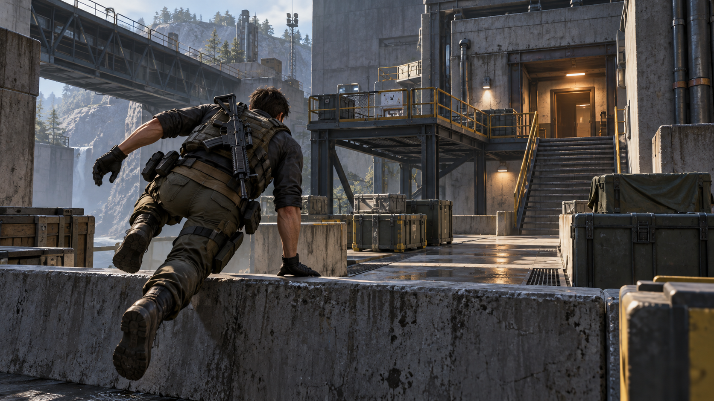

# OFFSET

Unreal Engine 5.6 · C++ 기반 싱글플레이 FPS 포트폴리오 프로젝트입니다.

*목표를 표현한 AI 생성 콘셉트 이미지이며, 실제 게임 화면은 아닙니다.*

## 프로젝트 목표

이동·파쿠르·전투·대사 선택이 자연스럽게 이어지는 하나의 미션을 완성합니다. 체크포인트로 진행 상황을 복원하고, 서버 이벤트 기록으로 플레이 흐름과 오류를 추적할 수 있도록 만드는 것이 목표입니다.

## 현재 개발 현황

*2026-10-29 기준 — 이동 기능 개발·검증 중*

- 이동 시험장과 미션용 맵 구성
- 기본 이동 및 시점 회전 확인
- 걷기·뛰기 전환 구현
- 이동 속도에 따라 높이가 달라지는 도움닫기 점프 구현
- 공중·착지 시 뛰기 전환 처리 및 점프 기합 적용

파쿠르·전투·미션 진행·저장·서버 연동은 이후 개발 예정입니다.
